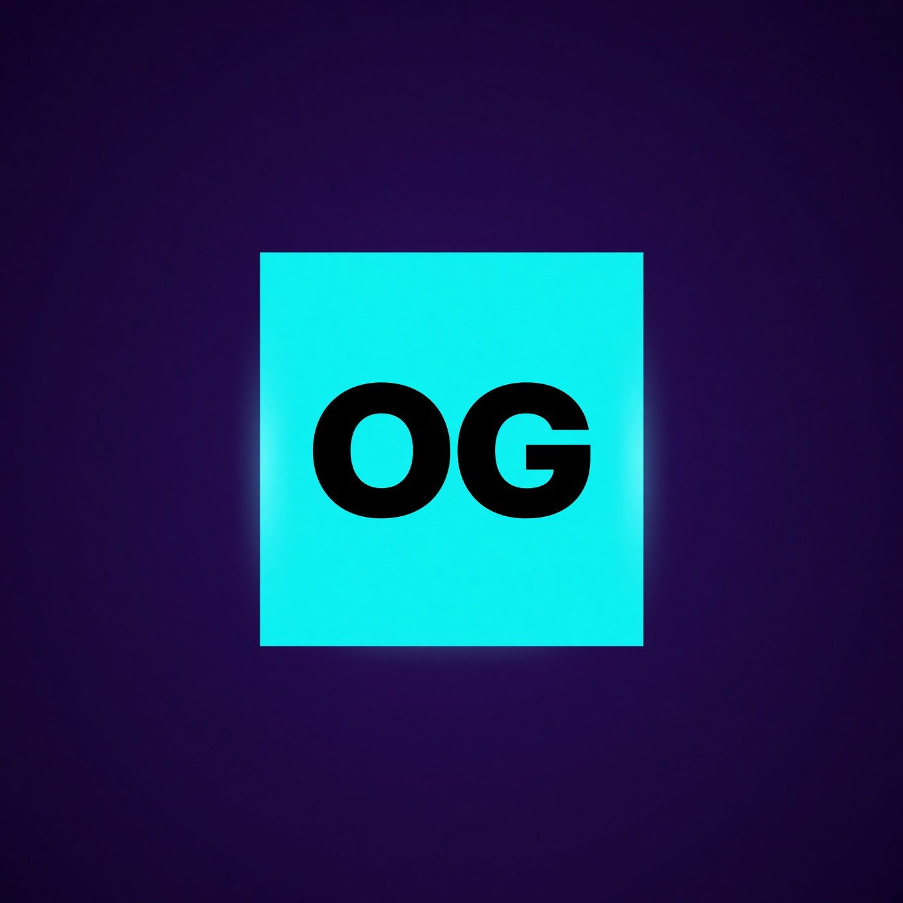
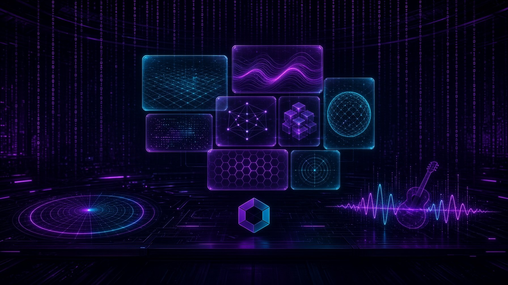
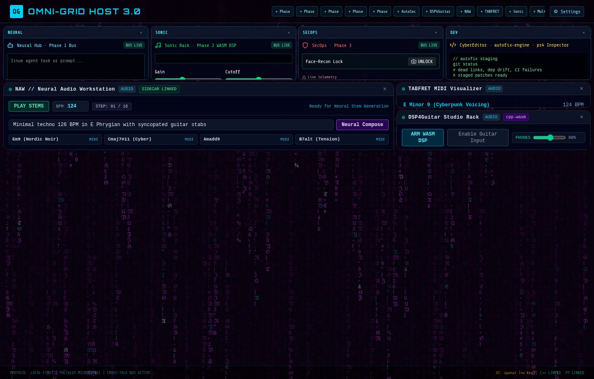
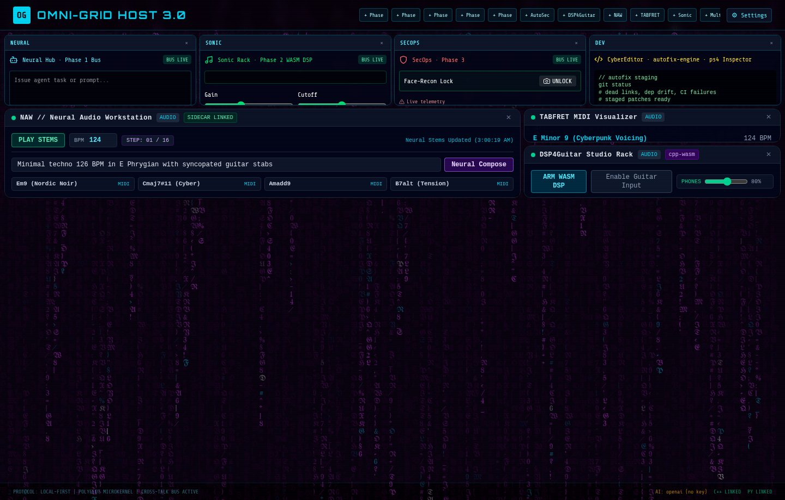
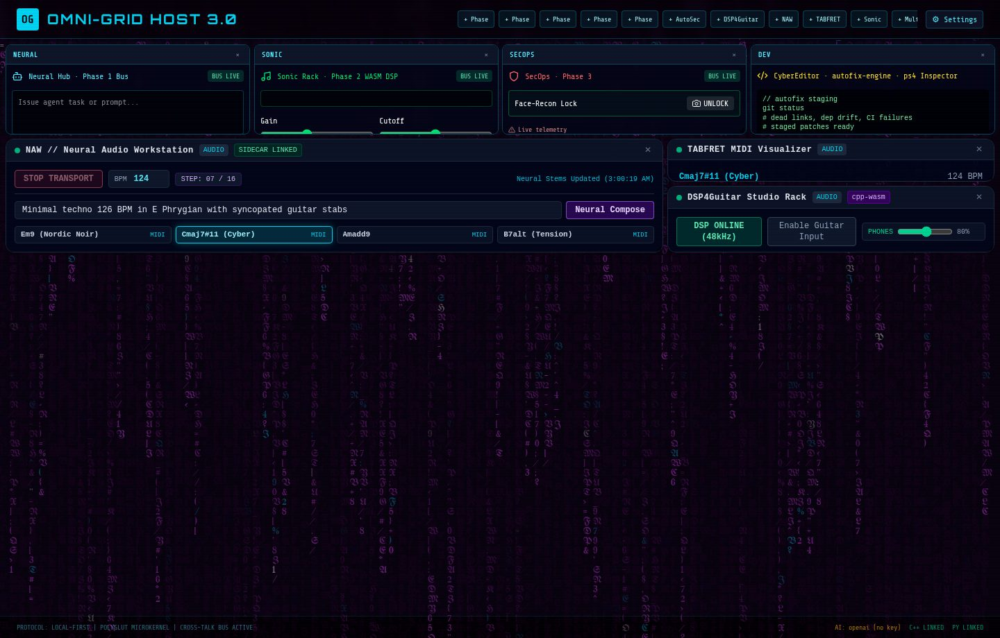
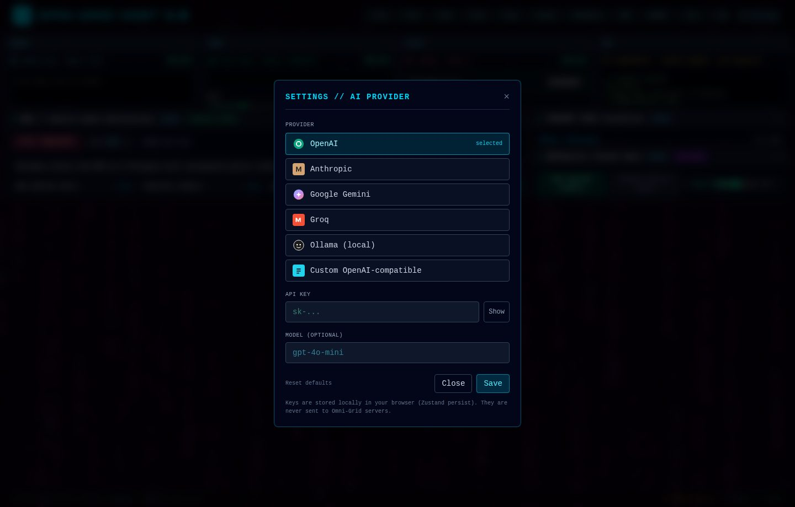
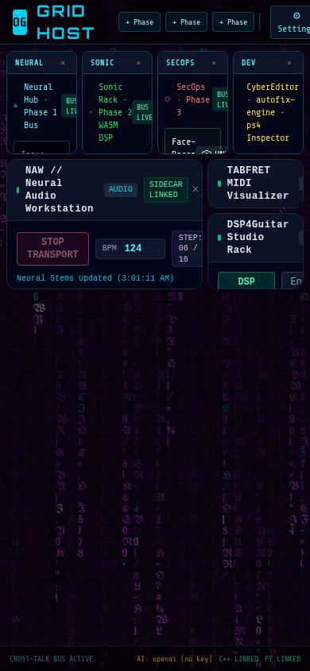

# Omni-Grid Host 3.0

**Polyglot Microkernel Desktop Host** — Unified application realizing the architectural blueprint.

<p align="center">
  
</p>

> "The grid is awake. I am Jon-Arve Constantine. If the rain is moving, you are already inside."



**Live desk:** [omni-grid-host.vercel.app](https://omni-grid-host.vercel.app)

## The desk

Four core tiles across the top. The audio chain — NAW, TABFRET, DSP4Guitar — sits underneath. The footer is the sidecar link: **C++ LINKED**, **PY LINKED**, and the provider slot.

**Widgets** opens the Omni-Grid 2.0 library (40+ tiles: weather, cyber editor, marketplace, sudoku, prompt lab, and the rest). Search by name. New tiles drop into the next open cell at a readable size, and the desk scrolls instead of crushing them. **Grid locked** keeps every tile still.

| Desk | Audio chain |
| --- | --- |
|  |  |

| Transport | Settings | Phone |
| --- | --- | --- |
|  |  |  |

Press **PLAY STEMS** on NAW. The ribbon sends the chord to TABFRET. DSP4Guitar follows the same MIDI. **⚙ Settings** stores a provider and key in the browser only.

Brand marks live in [docs/assets](docs/assets) and are served from `public/brand/` (`mark.jpg`, `icon.jpg`, `banner.jpg`).

## Documentation

| Guide | Read it for |
|-------|-------------|
| [docs/README.md](docs/README.md) | Architecture, phases, API, the full map |
| [docs/OPERATOR-MANUAL.md](docs/OPERATOR-MANUAL.md) | What is on screen and how a session goes |
| [docs/TIPS-AND-TRICKS.md](docs/TIPS-AND-TRICKS.md) | The short moves that save a session |
| [docs/AUDIO-DESK.md](docs/AUDIO-DESK.md) | NAW, TABFRET, and DSP4Guitar as one instrument |
| [docs/SIDECARS.md](docs/SIDECARS.md) | C++ analyzer, Python sidecar, Phase 1 bus |
| [docs/GREETINGS.md](docs/GREETINGS.md) | Jon-Arve Constantine, at length |
| [docs/PHASES.md](docs/PHASES.md) | Phases 1–9 |
| [docs/ARCHITECTURE.md](docs/ARCHITECTURE.md) | Microkernel, isolation, persistence |
| [docs/WIDGET-DEVELOPMENT.md](docs/WIDGET-DEVELOPMENT.md) | Writing a tile |

## AI Provider Settings

Click **⚙ Settings** in the header to set:

- **Provider**: OpenAI, Anthropic, Gemini, Groq, Ollama (local), or custom OpenAI-compatible
- **API Key**: Stored locally in the browser (never sent to Omni-Grid servers)
- **Base URL** (for Ollama / custom)
- **Model** (optional override)

Widgets and services can read the config via `useSettingsStore` or `getAiConfig()`. Neural Hub, Neural Chat, the editor, Write Pad, and the other Omni-Grid 2.0 tiles use that same key. Gemini answers from the browser. **Install** in the marketplace also opens the tile on the desk.

## Quick Start

```bash
npm install
npm run dev          # http://localhost:5173
npm run dev:full     # daemon + Vite
```

For packet telemetry and the Python composer, also build and run the C++ server. It spawns Uvicorn. See [docs/SIDECARS.md](docs/SIDECARS.md). The footer should read **C++ LINKED** and **PY LINKED**.

## Phases

| Phase | Status | Summary |
|-------|--------|---------|
| 1 | ✅ | WebSocket daemon + process supervisor |
| 2 | ✅ | DSP4Guitar AudioWorklet + live input + volume knobs |
| 3 | ✅ | SecOps Sentinel (radar, biometric lock, playbooks) |
| 4 | ✅ | Tauri host + dynamic plugin loader + CLI bundler |
| 5 | ✅ | Multi-workspace, HoverMind capture, agent mesh, audit log |
| 6 | ✅ | Agent autonomy + adaptive learning |
| 7 | ✅ | Self-healing and fault tolerance |
| 8 | ✅ | Quantum-resistant encryption (hybrid PQC) |
| 9 | ✅ | Self-healing network (topology, reroute) |

Spawn **Phase 5 Enterprise Mesh** from the PluginLauncher to use workspaces, route agent tasks, arm HoverMind (Alt+Shift+H), and inspect the audit log.

Press **PLAY STEMS** on NAW to drive TABFRET and DSP4Guitar. Click or drag a chord on the ribbon to audition it.

## Key Paths

- `docs/` — full documentation, including the operator's greetings
- `src/services/phase5.ts` — Phase 5 store
- `src/services/sidecarBridge.ts` — C++ and Python link
- `src/native-plugins/naw/` — multi-stem timeline
- `scripts/omni-plugin-cli.ts` — Repo-to-Widget bundler
- `dsp/dsp4guitar_wasm.cpp` — real-time DSP core

## CLI

```bash
npm run plugin:bundle -- --repo https://github.com/GizzZmo/TABFRET --category AUDIO
npm run plugin:sync-all
```

---

Built on the Omni-Grid 2.0 chassis. Repository: https://github.com/GizzZmo/Omni-Grid-Host

## Architecture Implemented

- **Frontend Shell**: React 19 + TypeScript + Zustand + Tailwind CSS + react-grid-layout (Bento tiles)
- **Extension SDK**: `OmniExtensionManifest` with runtime bridges, permissions, and Cross-Talk contracts
- **Cross-Talk Bus**: Typed event bus for inter-widget payloads (`audio/midi`, `sec/pcap-packet`, `ai/agent-task`, `ai/prompt`, …)
- **Widget System**: Sandboxed Bento widgets with drag handles, close, and launcher
- **Runtime Bridges**:
  - Python Sidecar (FastAPI) for Master-Agentic-AI, Face-Recon, Neural Compose replies
  - C++ WebSocket daemon for Network-Analyzer
  - WASM / AudioWorklet for DSP4Guitar
  - Node daemon for process supervision

## Extension Packs (from blueprint)

1. Neural & Agentic Core
2. Sonic & Neural DAW Suite
3. SecOps & Biometric Sentinel
4. DevOps & Self-Healing Forge
5. Creative, Studio & Gaming

## Phase 1 Daemon

A Node.js WebSocket bus + process supervisor is included:

```bash
npm run daemon
# → ws://127.0.0.1:8765
# → http://127.0.0.1:8765/health
```

Control messages:

- `{ "type": "system/spawn", "data": { "id": "python", "command": "python3", "args": ["server/workers/unified_sidecar.py"] } }`
- `{ "type": "system/stop", "data": { "id": "python" } }`

All other messages are relayed as Cross-Talk.

## Tauri Host Skeleton

A minimal Tauri 2 skeleton wraps the React app:

```bash
npm install -D @tauri-apps/cli
npm run tauri:dev
```

The skeleton lives in `src-tauri/`. Inside Tauri the sidecars are dialed on their direct ports. In the browser they are proxied on the dev server. See [docs/SIDECARS.md](docs/SIDECARS.md).

## Phase 2 — AudioWorklet DSP

- `public/worklets/dsp4guitar-worklet.js` and `public/worklets/omni-dsp-processor.js`
- Live guitar input, INPUT gain, PHONES gain
- MIDI from NAW / TABFRET triggers Karplus-Strong

```bash
npm run dev
# DSP4Guitar → ARM WASM DSP → Enable Guitar Input
```

## Phase 3 — SecOps

- SecOps Sentinel: polar threat radar fed by the C++ sidecar
- Face-Recon lock blurs the grid while engaged
- Anomaly spikes from the unprivileged analyzer exercise the radar without libpcap

---

> "Go on. The sixteenth notes are not going to play themselves. That is a lie. They will. Be there anyway."  
> — Jon-Arve Constantine
